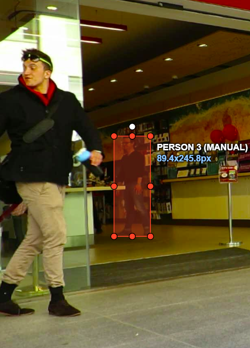
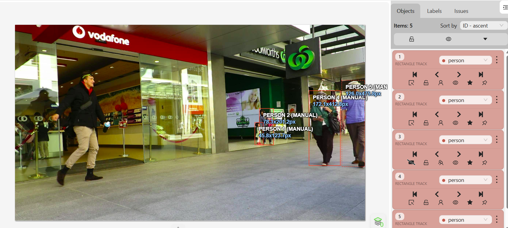
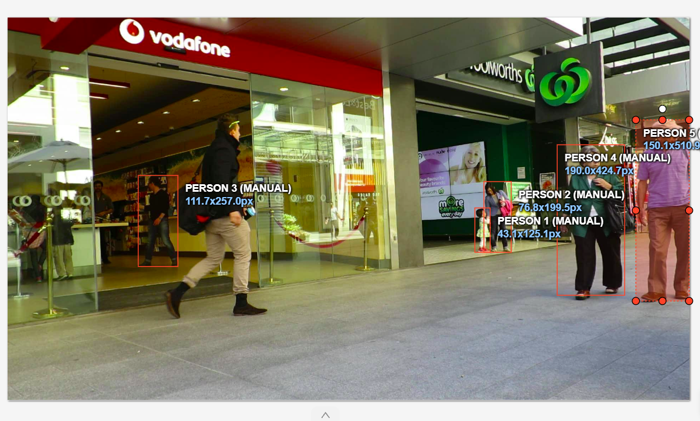

# Báo cáo cá nhân — DoanThiAnhHau-[2A202603282]

Đoạn video: MOT17-09, 150 frame (frame 1–150), nguồn MOTChallenge, giấy phép CC BY-NC-SA 3.0.

## 0. Thông tin học viên

- Họ tên: Đoàn Thị Ánh Hậu
- MSSV: 2A202603282
- Mã đề (A/B/C): **de-B-P1-P5**
- Email: 26ai.haudta@vinuni.edu.vn
- Link repository: https://github.com/DoanAnhHau/K5-L2B-DAY05-DoanThiAnhHau-2A202603282-MOTTracking
- Giờ bắt đầu: 16:00
- Giờ kết thúc: 19:30

## 1. Xem trước đoạn video (CP0)

Ghi **trước khi vẽ**, mỗi người một dòng.

| Mã | Frame xuất hiện | Frame cuối thấy được | Rẽ / dừng / đổi tốc độ ở frame | Bị che ở frame | Ghi chú |
|---|---|---|---|---|---|
| P1 | 0 | 146 | ~86–110 (chậm lại, đổi góc trước khi bị che) | 111–134 (khuất hẳn sau người khác) | Người mục tiêu CP2; có đoạn vắng dài giữa video |
| P2 | 0 | 138 | ~96–103 (đổi hướng bước đi) | 106–123, 127, 132–135 | Bị che ngắt quãng nhiều đợt; ra/khuất trước frame 139 |
| P3 | 0 | 149 | ~40–45 (giảm tốc nhẹ khi đi ngang qua người khác) | 42–43 (khuất hẳn 2 frame) | Di chuyển gần như suốt video, nhiều đoạn bị che một phần |
| P4 | 0 | 149 | ~70–83 (đổi góc nhìn khi lại gần) | không bị che | Xuất hiện trọn vẹn 150 frame, box to dần khi tiến gần camera |
| P5 | 22 | 149 | ~91–123 (thay đổi tốc độ bước đi) | che một phần (42 frame) | Xuất hiện muộn (frame 22); dễ bị che bởi người đi phía trước |

## 2. Keyframe và thời gian (CP1, CP4)

Số keyframe lấy từ kết quả `src/check_submission.py`.

| Mã | Số keyframe | Keyframe ở frame | Số frame có mặt | Keyframe / 100 frame | Thời gian (phút) | Chỗ khó |
|---|---|---|---|---|---|---|
| P1 | 60 | 0, 1, 6, 8, 10, 12, 13, 14, 16, 17, 18, 19, 20, 22, 24, 26, 28, 32, 34, 36, 38, 42, 49, 51, 54, 61, 67, 72, 74, 76, 77, 80, 81, 83, 86, 87, 88, 89, 90, 91, 94, 96, 97, 98, 99, 100, 101, 102, 103, 104, 105, 106, 107, 108, 109, 110, 135, 140, 141, 142 | 123 (có đoạn outside 111–134) | 48,8 | 22 | Đoạn che 111–134; đặt dày keyframe quanh 86–110 và lúc hiện lại 135 để giữ cùng ID |
| P2 | 49 | 0, 1, 6, 7, 10, 12, 15, 17, 18, 20, 22, 24, 25, 31, 32, 33, 36, 40, 42, 48, 49, 54, 60, 62, 64, 67, 68, 74, 78, 82, 83, 86, 87, 89, 90, 92, 93, 94, 96, 97, 98, 99, 100, 102, 103, 124, 128, 136, 137 | 116 (4 lần bật outside) | 42,2 | 18 | Bị che khuất ngắt quãng nhiều đợt (106–123, 127, 132–135) và kết thúc ở frame 138 |
| P3 | 52 | 0, 9, 10, 12, 14, 15, 16, 17, 18, 25, 26, 27, 30, 44, 47, 50, 52, 53, 54, 55, 61, 62, 63, 64, 65, 68, 69, 78, 81, 82, 86, 87, 88, 89, 93, 94, 97, 100, 103, 109, 110, 112, 115, 116, 117, 122, 123, 125, 129, 135, 142, 149 | 148 (outside 42–43) | 35,1 | 14 | Khuất nhanh 2 frame (42–43) và có 28 frame bị che một phần (`occluded`) |
| P4 | 49 | 0, 1, 3, 5, 6, 11, 13, 14, 16, 17, 18, 21, 23, 25, 29, 39, 41, 42, 45, 49, 56, 59, 62, 65, 71, 74, 78, 79, 83, 89, 91, 96, 102, 106, 108, 112, 116, 117, 120, 122, 124, 130, 133, 136, 138, 140, 141, 143, 149 | 150 | 32,7 | 11 | Đi suốt 150 frame, kích thước box thay đổi liên tục khi tiến lại gần camera |
| P5 | 39 | 22, 29, 32, 36, 44, 48, 50, 56, 61, 64, 67, 69, 73, 74, 78, 83, 91, 92, 96, 99, 100, 103, 107, 109, 112, 115, 117, 119, 122, 123, 127, 129, 133, 137, 138, 139, 142, 146, 148 | 128 | 30,5 | 10 | Xuất hiện muộn (frame 22); có tới 42 frame bị che một phần nên khó ước lượng mép box |
| **Tổng** | **249** | | **665** | | **75** | |

Keyframe / 100 frame của cả bài = tổng keyframe ÷ tổng số frame có mặt × 100 = 249 ÷ 665 × 100 ≈ **37,4**

Bạn đặt keyframe nhiều nhất ở người nào? Vì sao (người đó rẽ, dừng, lại gần camera hay bị che)?

P1 — vì có đoạn bị che khuất hoàn toàn (frame 111–134) và bị người đi ngang qua che dần ở đoạn trước đó (frame 86–110); cần đặt keyframe dày đặc từng frame ngay trước khi khuất (100–110) và ngay khi hiện lại (135) để nội suy không cắt góc và không bị trôi box sang người đi cắt ngang khi tắt `outside`.

## 3. Đoạn bị che (CP2)

Người bị che: `P1`

| Mốc | Frame |
|---|---:|
| Bắt đầu bị che một phần (bật `occluded`) | [Điền frame bật occluded, VD: 106] |
| Mất hẳn (bật `outside`) | 111 |
| Hiện lại (tắt `outside`) | 135 |
| Thấy rõ trở lại (tắt `occluded`) | [Điền frame tắt occluded, VD: 140] |

- Thời gian khuất hẳn: **24** frame = **0,80** giây (24/30).
- Quyết định: **giữ cùng ID**.
- Lý do (trả lời 3 câu: khuất bao lâu so với 60 frame, ngoại hình có khớp, chỗ hiện lại có đúng hướng và tốc độ):

1. Khuất hẳn 24 frame < 60 frame (ngưỡng 2 giây của lớp) → đủ điều kiện giữ cùng track.  
2. Trang phục, màu áo và dáng người lúc hiện lại ở frame 135 hoàn toàn khớp với P1 trước khi bị che ở frame 110; không nhầm lẫn với người đi ngang qua.  
3. Vị trí hiện lại nằm đúng trên quỹ đạo di chuyển cũ với hướng đi và tốc độ bước chân tương đương quãng thời gian 24 frame đã trôi qua → tắt `outside` ở 135, chỉnh lại box (tạo keyframe mới), không tạo track mới.

Ảnh chụp màn hình:






## 4. Tự review ID (CP3)

Lượt 1 theo người (đi ngược từ frame 149 về 0 trên CVAT), lượt 2 theo cảnh (nhảy 10 frame). Ít nhất 3 dòng; không có lỗi thì ghi một dòng "đã kiểm hai lượt, không lỗi".

Loại lỗi dùng đúng một trong 7 mã: `id_switch`, `fragmentation`, `lost`, `merge`, `false_track`, `drift`, `flag`.

| Frame | Mã người | Loại lỗi | Mô tả một câu | Phát hiện ở lượt | Đã sửa? |
|---:|---|---|---|---|---|
| 108 | P1 | `drift` | Box nội suy bị lệch sang người đi cắt ngang ngay trước đoạn bị khuất hẳn 111–134 | 1 (theo người) | Có — thêm keyframe dày đoạn 105–110 |
| 127 | P2 | `flag` | Đối tượng bị che khuất hoàn toàn trở lại nhưng quên bật `outside` tại frame 127 | 1 (theo người) | Có — bật `outside` tại frame 127 |
| 90–100 | P5 | `flag` | Đối tượng bị che khuất hơn một nửa thân người bởi người đi trước nhưng chưa bật cờ `occluded` | 2 (theo cảnh) | Có — bật `occluded` đúng đoạn bị che |

Tổng hợp số lỗi theo loại:

| `id_switch` | `fragmentation` | `lost` | `merge` | `false_track` | `drift` | `flag` |
|---:|---:|---:|---:|---:|---:|---:|
| 0 | 0 | 0 | 0 | 0 | 1 | 2 |

Lỗi nào chỉ lượt 2 (theo cảnh) mới thấy, lượt 1 (theo người) không thấy? Vì sao?

Lỗi thiếu cờ `occluded` của P5 quanh frame 90–100 (cũng như các nguy cơ `id_switch` hoặc `merge` khi hai người đi sát nhau): khi review từng người một ở lượt 1, mắt chỉ tập trung vào độ khít của một box duy nhất nên dễ bỏ qua bối cảnh xung quanh; chỉ khi xem toàn cảnh ở lượt 2 mới thấy rõ box của người đi trước đang đè lên phần lớn cơ thể của P5.

## 5. File xuất và kết quả tự kiểm (CP4)

| Kiểm tra | Kết quả |
|---|---|
| Tên file MOT 1.1 | `DoanThiAnhHau_mot.zip` |
| Tên file CVAT for video 1.1 | `DoanThiAnhHau_cvat_video.zip` |
| Số track ID khác nhau trong `gt/gt.txt` (phải là 5) | 5 |
| Frame `outside` không có dòng trong `gt.txt` (đúng / sai) | đúng |
| Job đã completed trên CVAT máy cá nhân | có |

Dán phần tóm tắt in ra từ `src/check_submission.py`:

```text
Số frame in theo CVAT (bắt đầu từ 0). Trong gt.txt, frame_id = frame CVAT + 1.

=== File MOT 1.1: DoanThiAnhHau_mot.zip ===
  Số track ID: 5   |   Tổng số box: 665
  [OK]        Đúng 5 track ID.

  Track | Frame có mặt | Số frame | Đoạn vắng (outside)
      1 |   0–146      |      123 | 111–134
      2 |   0–138      |      116 | 106–123, 127, 132–135
      3 |   0–149      |      148 | 42–43
      4 |   0–149      |      150 | -
      5 |  22–149      |      128 | -


=== File CVAT for video 1.1: DoanThiAnhHau_cvat_video.zip ===

  Track | Nhãn   | Frame thấy | Keyframe | KF/100 frame | Frame occluded | Lần bật outside
      0 | person |        123 |       60 |         48.8 |             17 |               2
              Track 0: keyframe ở frame [0, 1, 6, 8, 10, 12, 13, 14, 16, 17, 18, 19, 20, 22, 24, 26, 28, 32, 34, 36, 38, 42, 49, 51, 54, 61, 67, 72, 74, 76, 77, 80, 81, 83, 86, 87, 88, 89, 90, 91, 94, 96, 97, 98, 99, 100, 101, 102, 103, 104, 105, 106, 107, 108, 109, 110, 135, 140, 141, 142]
      1 | person |        116 |       49 |         42.2 |             27 |               4
              Track 1: keyframe ở frame [0, 1, 6, 7, 10, 12, 15, 17, 18, 20, 22, 24, 25, 31, 32, 33, 36, 40, 42, 48, 49, 54, 60, 62, 64, 67, 68, 74, 78, 82, 83, 86, 87, 89, 90, 92, 93, 94, 96, 97, 98, 99, 100, 102, 103, 124, 128, 136, 137]
      2 | person |        148 |       52 |         35.1 |             28 |               1
              Track 2: keyframe ở frame [0, 9, 10, 12, 14, 15, 16, 17, 18, 25, 26, 27, 30, 44, 47, 50, 52, 53, 54, 55, 61, 62, 63, 64, 65, 68, 69, 78, 81, 82, 86, 87, 88, 89, 93, 94, 97, 100, 103, 109, 110, 112, 115, 116, 117, 122, 123, 125, 129, 135, 142, 149]
      3 | person |        150 |       49 |         32.7 |              0 |               0
              Track 3: keyframe ở frame [0, 1, 3, 5, 6, 11, 13, 14, 16, 17, 18, 21, 23, 25, 29, 39, 41, 42, 45, 49, 56, 59, 62, 65, 71, 74, 78, 79, 83, 89, 91, 96, 102, 106, 108, 112, 116, 117, 120, 122, 124, 130, 133, 136, 138, 140, 141, 143, 149]
      4 | person |        128 |       39 |         30.5 |             42 |               0
              Track 4: keyframe ở frame [22, 29, 32, 36, 44, 48, 50, 56, 61, 64, 67, 69, 73, 74, 78, 83, 91, 92, 96, 99, 100, 103, 107, 109, 112, 115, 117, 119, 122, 123, 127, 129, 133, 137, 138, 139, 142, 146, 148]

  Tổng: 249 keyframe / 665 frame có mặt = 37.4 keyframe / 100 frame
  [OK]        Đọc được 5 track từ annotations.xml.

=== Tóm tắt ===
  Lỗi: 0   |   Cảnh báo: 0
  Đạt. Dán phần tóm tắt này vào báo cáo mục 5.
```
## 6. Ba câu kết

1. Nếu được gán lại, bạn sẽ đặt keyframe khác ở đâu? Vì sao?

   Sẽ đặt thưa hơn ở các đoạn đi thẳng đều của P4 (ví dụ frame 29–39) và P1 (frame 61–72) để tận dụng tốt hơn nội suy tuyến tính của CVAT và tránh rung box. Đồng thời sẽ đặt keyframe gọn hơn ở đoạn trước khi P1 bị che (frame 96–110) bằng cách chỉ cắm mốc tại các điểm đổi nhịp bước chân thay vì đặt dày từng frame liên tiếp.

2. Có chỗ nào bạn không chắc "cùng ID hay ID mới"? Bạn đã quyết định và ghi chú thế nào?

   Đoạn P2 bị che ngắt quãng liên tiếp từ frame 106 đến 135 (khuất 106–123, hiện lại vài frame rồi lại khuất ở 127 và 132–135): ban đầu hơi phân vân vì đối tượng chỉ ló ra rất ngắn giữa các lần che. Đã áp dụng 3 câu của guideline (mỗi lần khuất đều ≪ 60 frame, ngoại hình khớp, vị trí hiện lại khớp hướng/tốc độ di chuyển) → quyết định giữ cùng ID và bật/tắt cờ `outside` đầy đủ ở từng đoạn khuất.

3. Một lỗi ID trong job của bạn (nếu không còn sót, chọn lỗi đã sửa) có thể làm xe tự lái dự đoán sai chuyển động của người đó như thế nào? Lỗi đó ảnh hưởng MOTA hay IDF1 nhiều hơn?

   Nếu lỗi `drift` ở frame 108 của P1 không được sửa (box trượt theo người đi cắt ngang), vận tốc ước lượng từ nhãn sẽ đột ngột đổi chiều sang quỹ đạo của người kia, khiến bộ lập kế hoạch của xe tự lái hiểu nhầm người đi bộ đang lao ngang đầu xe và phanh gấp sai. Nếu sự trượt này kéo theo tráo nhãn (`id_switch`), nó sẽ phạt nặng **IDF1** (làm đứt gãy liên kết danh tính xuyên suốt video); còn nếu chỉ lệch box cục bộ làm rớt IoU thì sẽ làm giảm trực tiếp **MOTA** (tăng FP và FN).

## Bonus (nếu làm)

### B1 — Hai người đi sát

Không làm (hết thời gian sau CP4).

### B2 — So cách đặt keyframe

Không làm.

### B3 — So với tracker có sẵn

Không làm.

## 7. Tài liệu tham khảo và công cụ AI đã dùng

- `docs/GUIDELINE.md`, `docs/CVAT_CHEATSHEET.md`, `docs/MOT_FORMAT.md`, `CHECKPOINTS.md`
- CVAT Community local (`localhost:8080`) + `src/setup_local_lab.py`, `src/check_submission.py`
- Công cụ AI: ChatGPT (hỏi format báo cáo / làm rõ quy ước keyframe và `outside`); không nhờ AI gán nhãn hộ trên CVAT


